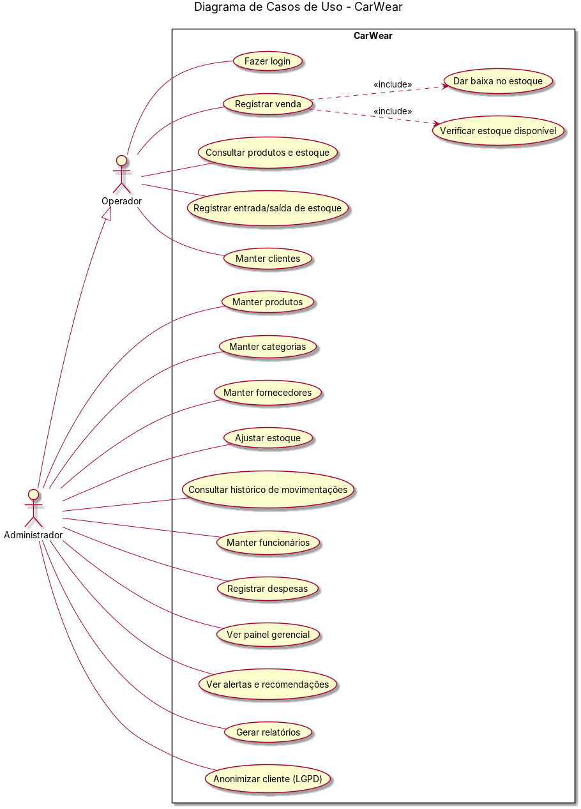
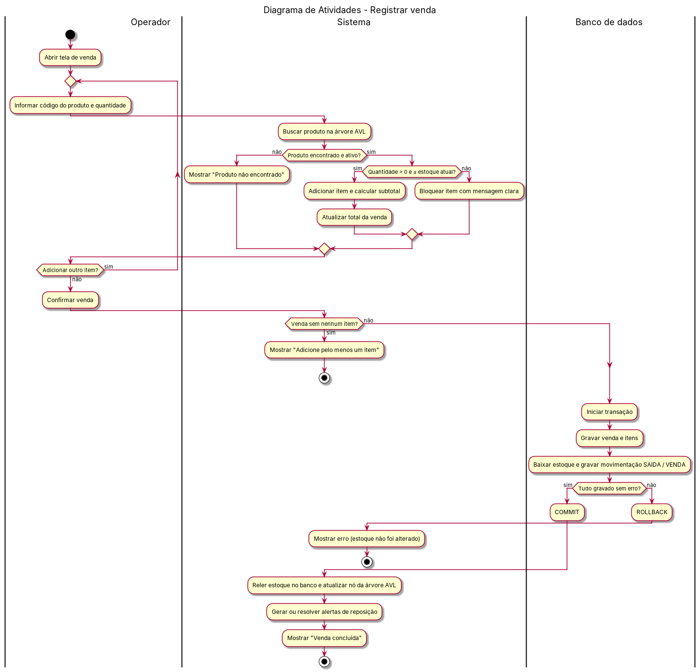
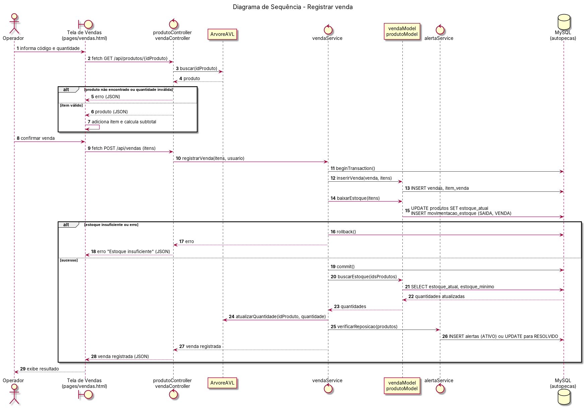
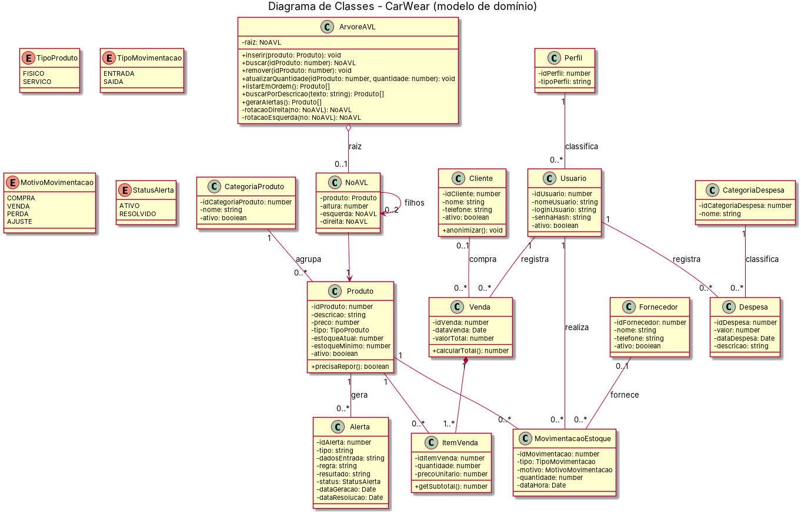

# Design – CarWear

Este documento explica como o sistema foi pensado: a arquitetura, as decisões de design, os diagramas UML, o fluxo principal e o tratamento de dados pessoais (LGPD).

- Requisitos e histórias de usuário: [requisitos.md](requisitos.md)
- Testes: [testes.md](testes.md)
- Implantação: [implantacao.md](implantacao.md)
- Banco de dados: [../banco-de-dados/](../banco-de-dados/)

## 1. Arquitetura

O CarWear é uma **aplicação web em JavaScript**: o servidor roda em **Node.js** com **Express**, e o banco é **MySQL 8**. O código segue o padrão **MVC (Model-View-Controller) com uma adaptação**: além de Model, View e Controller, há uma camada de **serviços** para as regras de negócio e uma pasta própria para a **árvore AVL**.

**Como as telas funcionam.** O `src/views/index.html` é a página principal, com o menu lateral e o cabeçalho. Quando o usuário clica num item do menu, o script `src/public/js/layout.js` carrega a tela daquele módulo (`src/views/pages/estoque.html`, `pages/vendas.html`...) sem recarregar a página. As telas usam **Bootstrap 5**, **Bootstrap Icons** e **Chart.js** (gráficos do dashboard). Os dados vêm do servidor por `fetch`, em chamadas à **API** (`/api/...`), que responde em **JSON**.

| Camada | Pasta | Responsabilidade |
|---|---|---|
| **View** | `src/views` (`index.html` e `pages/`) e `src/public` (`css/`, `js/`) | Telas em HTML com Bootstrap. Mostram os dados e enviam os pedidos à API com `fetch`. |
| **Rotas** | `src/routes` | Ligam cada endereço da API (ex.: `GET /api/produtos`, `POST /api/vendas`) ao controller certo. |
| **Middlewares** | `src/middlewares` | Conferem se o usuário está logado e se o perfil dele pode usar aquela rota. |
| **Controller** | `src/controllers` | Recebe o pedido, valida os dados de entrada, chama o serviço e devolve a resposta em JSON. Ex.: `produtoController`, `estoqueController`, `vendaController`. |
| **Service (adaptação do MVC)** | `src/services` | Onde ficam as regras de negócio: validar a venda, controlar a transação, gerar alertas, calcular a curva ABC. Ex.: `estoqueService`, `vendaService`, `alertaService`. |
| **Estrutura de dados** | `src/estruturas` | `ArvoreAVL.js` e `NoAVL.js`: os produtos em memória. |
| **Model** | `src/models` | Faz o SQL de cada tabela do banco, sempre com consultas parametrizadas (biblioteca `mysql2`). Ex.: `produtoModel`, `movimentacaoModel`. |
| **Configuração** | `src/config` | Conexão com o MySQL, lida das variáveis de ambiente (`.env` no computador, painel do Render na hospedagem). |
| **Banco de dados** | MySQL 8, schema `autopecas` (`database/schema/01.schema.sql`) | Guarda os dados de forma permanente. É a fonte oficial. |

Caminho de um pedido: **Tela (fetch) → Rota → Middleware → Controller → Service → (Árvore AVL e/ou Model) → MySQL**, e a resposta volta em JSON para a tela.

### 1.1 Estrutura de pastas

```
SistemaAutopecas/
├── server.js              inicia o servidor e monta a árvore AVL
├── package.json           dependências e comandos (npm start)
├── .env.example           modelo das configurações do banco
├── src/
│   ├── config/            conexão com o MySQL
│   ├── routes/            rotas da API de cada módulo
│   ├── middlewares/       login e permissão por perfil
│   ├── controllers/       recebem o pedido e devolvem JSON
│   ├── services/          regras de negócio e transações
│   ├── models/            SQL de cada tabela
│   ├── estruturas/        ArvoreAVL.js e NoAVL.js
│   ├── views/             index.html e pages/ (telas de cada módulo)
│   └── public/            css/ e js/ (estilo e scripts das telas)
├── database/
│   ├── schema/            01.schema.sql
│   └── seed/              dados iniciais
├── tests/                 testes
└── docs/                  documentação
```

## 2. Decisões de design

| # | Decisão | Por quê |
|---|---|---|
| D1 | Aplicação **web** | A loja só precisa de um navegador; não precisa instalar nada em cada computador. |
| D2 | **Node.js com Express** no servidor | O grupo usa JavaScript na tela e no servidor, então é uma linguagem só. O Express é simples e muito usado para APIs web. |
| D3 | Padrão **MVC com camada de serviços** | Cada parte tem uma função só. As regras de negócio ficam nos services, e não espalhadas nos controllers, o que facilita testar e mudar (RNF18). |
| D4 | Telas em **HTML com Bootstrap 5**, Bootstrap Icons e Chart.js | O Bootstrap deixa as telas prontas e responsivas sem complicar o projeto; o Chart.js desenha os gráficos do dashboard (RNF21). React só será usado se for realmente necessário. |
| D5 | **Página única** (`index.html`) que carrega cada tela, e servidor como **API JSON** | O menu e o cabeçalho ficam fixos e só o conteúdo muda. A tela e o servidor ficam separados: a tela só mostra, e as regras ficam no servidor. |
| D6 | Banco **MySQL 8 com InnoDB** | Banco relacional gratuito e conhecido pelo grupo; o InnoDB dá suporte a transações e chaves estrangeiras (RNF14, RNF16). |
| D7 | Hospedagem no **Render** | Publica direto do GitHub e tem plano gratuito para aplicações Node.js. Como o Render não tem MySQL gerenciado, o banco fica em um serviço MySQL externo (veja [implantacao.md](implantacao.md)). |
| D8 | **Árvore AVL** de produtos em memória, com chave `id_produto` | A busca pelo código custa O(log n). A árvore é balanceada, então não vira uma lista mesmo com os produtos chegando do banco em ordem (RF41). |
| D9 | O banco é a **fonte oficial** | A árvore só é atualizada depois do commit. Se algo falhar, ou se o servidor reiniciar, ela é montada de novo a partir do banco. |
| D10 | Venda, itens e baixa do estoque **na mesma transação** | Ou grava tudo, ou não grava nada (`beginTransaction`, `commit` e `rollback` do `mysql2`). O estoque nunca fica pela metade (RN04). |
| D11 | Toda mudança de estoque vira uma **movimentação** (tipo + motivo) | O histórico mostra de onde veio cada alteração: compra, venda, perda ou ajuste (RF15). |
| D12 | **Inativar** em vez de excluir | Produtos, clientes, fornecedores e usuários já usados continuam no histórico. As chaves estrangeiras não usam CASCADE (RN06). |
| D13 | Preço gravado **no item da venda** (`preco_unitario`) | Venda antiga mostra o preço daquela época, mesmo que o produto mude de preço depois (RF20). |
| D14 | Senha com **hash bcrypt** e login por **sessão** | Mesmo que alguém veja o banco, não descobre as senhas. A sessão guarda quem está logado e o perfil (RN08). |
| D15 | Permissão verificada **no servidor** (middleware) | Esconder o botão não basta; o middleware recusa o pedido do Operador para rotas de Administrador (RNF02). |
| D16 | Consultas **parametrizadas** (`?` no SQL) | Impede injeção de SQL (RNF03). |
| D17 | "Inteligência" por **regras explícitas** | Cada alerta guarda e mostra os dados de entrada, a regra e o resultado (colunas da tabela `alertas`), então o usuário entende por que ele apareceu (RN10). Não usamos IA generativa. |

## 3. Diagramas UML

Os arquivos-fonte (`.puml`) e as imagens estão em [`uml/`](uml/). A versão em PDF está em [`pdf/`](pdf/).

### 3.1 Casos de uso



O **Administrador herda** os casos de uso do **Operador** (seta de generalização), então pode fazer tudo o que o Operador faz. O Operador vende, consulta o estoque, registra entradas e saídas e cadastra clientes; o Administrador cuida do resto, incluindo ajustes de estoque e a anonimização de clientes. "Registrar venda" sempre inclui "Verificar estoque disponível" e "Dar baixa no estoque".

### 3.2 Atividades – Registrar venda



Mostra o passo a passo da venda em três raias (Operador, Sistema e Banco de dados): adicionar itens, validar a quantidade, confirmar e gravar tudo em uma transação (venda, itens, baixa no estoque e movimentação de saída). Com COMMIT, a árvore AVL e os alertas são atualizados; com ROLLBACK, nada muda.

### 3.3 Sequência – Registrar venda



Mostra quais partes do código participam da venda e em que ordem trocam mensagens: a tela de vendas chama a API com `fetch`, e o `produtoController` busca o produto na `ArvoreAVL` e devolve os dados em JSON. Na confirmação, o `vendaController` chama o `vendaService`, que abre uma transação e grava a venda pelos models (`vendaModel` e `produtoModel`). Depois do commit, ele atualiza a árvore e pede ao `alertaService` para gerar ou resolver alertas.

### 3.4 Classes



O modelo de domínio segue as tabelas do banco `autopecas`: `Perfil`, `Usuario`, `CategoriaProduto`, `Produto`, `Cliente`, `Fornecedor`, `Venda`, `ItemVenda`, `MovimentacaoEstoque`, `Alerta`, `CategoriaDespesa` e `Despesa`. Os campos ENUM do banco viram constantes no JavaScript (`TipoProduto`, `TipoMovimentacao`, `MotivoMovimentacao`, `StatusAlerta`). No código, cada entidade tem um arquivo em `src/models` com as consultas SQL da tabela. Uma venda tem **um ou mais** itens (composição), e o cliente da venda é **opcional** (venda de balcão). As classes `ArvoreAVL` e `NoAVL` (pasta `src/estruturas`) guardam os produtos em memória.

O diagrama de implantação está em [implantacao.md](implantacao.md).

## 4. Fluxo funcional principal

Fluxo usado na demonstração, do cadastro até o acompanhamento:

1. **Administrador** entra no sistema e cadastra uma categoria (ex.: "Filtros") e um produto físico (ex.: "Filtro de óleo", preço R$ 35,00, estoque 10, mínimo 5). O sistema dá o código 1 ao produto e o insere na árvore AVL.
2. **Operador** entra no sistema e busca o produto pelo código 1. A busca passa pela árvore AVL.
3. **Operador** registra uma venda de 6 unidades. O sistema confere o estoque e grava a venda, o item, a baixa e a movimentação SAIDA / VENDA em uma única transação.
4. O estoque passa a ser 4. Como 4 ≤ 5, o sistema **gera um alerta de reposição** com os dados de entrada, a regra e o resultado.
5. **Operador** tenta vender 10 unidades. O sistema **bloqueia** com a mensagem "Estoque insuficiente" e não altera nada.
6. **Administrador** abre o painel e vê o faturamento, os mais vendidos e o alerta do filtro de óleo.
7. **Operador** registra uma entrada de 20 unidades (ENTRADA / COMPRA). O estoque vai para 24 e o alerta passa para RESOLVIDO.

## 5. Proteção de dados e privacidade (LGPD)

### 5.1 Dados pessoais tratados

| Dado | Finalidade | Onde fica | Quem acessa | Proteção |
|---|---|---|---|---|
| Nome e login do **usuário** | Entrar no sistema e saber quem fez cada operação | `usuarios.nome_usuario`, `usuarios.login_usuario` | Administrador | Acesso restrito; login não aparece em relatórios |
| Senha do **usuário** | Autenticação | `usuarios.senha_hash` | Ninguém (só o hash é guardado) | Hash com salt; fora de logs e exportações |
| Nome e telefone do **cliente** | Ligar a venda ao cliente e consultar o histórico de compras | `clientes.nome`, `clientes.telefone` | Operador (cadastrar, consultar e editar) e Administrador (também histórico e anonimização) | Acesso só para usuários logados; anonimização a pedido |
| Nome e telefone do **fornecedor** | Registrar compras e entradas de estoque | `fornecedores.nome`, `fornecedores.telefone` | Administrador | Tratado como dado pessoal quando o fornecedor for pessoa física ou MEI |
| Data e hora do **aceite do aviso de privacidade** | Comprovar que o usuário foi informado | `usuarios.data_aceite_lgpd` (coluna a criar) | Administrador | Somente leitura |

O sistema **não** coleta CPF, e-mail, endereço nem dados de pagamento de clientes, porque eles não são necessários para as funções do projeto (minimização, RNF06).

### 5.2 Medidas de proteção

- Senhas guardadas com hash e salt (bcrypt).
- Permissões verificadas no servidor: o Operador só vê os dados de clientes necessários para o atendimento e não acessa o histórico de compras nem o painel gerencial.
- Consultas SQL parametrizadas, contra injeção de SQL.
- Comunicação por HTTPS quando o sistema estiver em rede.
- Anonimização do cliente a pedido: o nome vira um texto genérico, o telefone é apagado e o cliente fica inativo, mas as vendas continuam no histórico (RF33).
- Aviso de privacidade no primeiro acesso, com registro do aceite (RF10).
- Backup diário do banco, com acesso restrito (RNF15).

### 5.3 Por que a LGPD se aplica

A LGPD (Lei nº 13.709/2018) vale para qualquer tratamento de dados de **pessoas físicas** feito por uma empresa. O CarWear guarda dados de clientes e de funcionários, então precisa seguir a lei:

- **Bases legais (art. 7º):** execução de contrato (a venda ao cliente e o vínculo com o funcionário) e legítimo interesse (histórico de compras da loja).
- **Segurança (art. 46):** as medidas da seção 5.2.
- **Direitos do titular (art. 18):** correção e anonimização dos dados do cliente.
