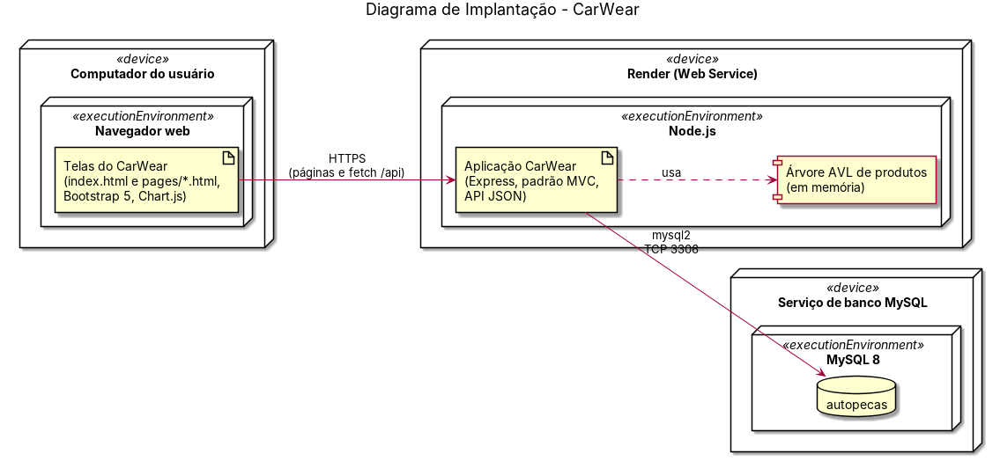

# Implantação – CarWear

Como o sistema é distribuído e o passo a passo para rodar no computador (desenvolvimento) e no Render (hospedagem).

## 1. Diagrama de implantação



| Nó | O que roda nele |
|---|---|
| **Computador do usuário** | Navegador com as telas do CarWear: `index.html` e as páginas de cada módulo, com Bootstrap 5, Bootstrap Icons e Chart.js. |
| **Render (Web Service)** | Node.js com a aplicação CarWear (Express, padrão MVC), que entrega as telas, responde a API em JSON e guarda a árvore AVL de produtos em memória. |
| **Serviço de banco MySQL** | MySQL 8 com o schema `autopecas`. |

O navegador conversa com a aplicação por **HTTPS**. A aplicação conversa com o banco pela biblioteca **mysql2**, por TCP (porta 3306 no MySQL comum).

**Onde fica o banco.** O Render não oferece MySQL gerenciado. Por isso, na hospedagem, o banco fica em um **serviço MySQL externo**, compatível com MySQL 8. Um exemplo com plano gratuito é o TiDB Cloud. Outra opção é rodar o MySQL dentro do próprio Render com Docker e disco, mas essa opção é paga. No computador de desenvolvimento, usa-se o MySQL instalado na própria máquina.

## 2. O que precisa estar instalado (desenvolvimento)

| Programa | Versão | Para quê |
|---|---|---|
| Git | qualquer recente | Baixar o projeto |
| Node.js (já vem com o npm) | 20 LTS ou superior | Rodar a aplicação e instalar as dependências |
| MySQL Server | 8.0 ou superior | Banco de dados (o script usa recursos do MySQL 8) |
| MySQL Workbench | opcional | Abrir o modelo `docs/banco-de-dados/modelo-er.mwb` e rodar os scripts |
| Navegador (Chrome, Edge ou Firefox) | atualizado | Usar o sistema |

## 3. Rodar no computador

### 3.1 Baixar o projeto

```bash
git clone https://github.com/<usuario>/SistemaAutopecas.git
cd SistemaAutopecas
```

### 3.2 Criar o banco de dados

1. Abrir o MySQL (pelo Workbench ou pelo terminal).
2. Rodar o script de criação do schema e das tabelas:
   ```bash
   mysql -u root -p < database/schema/01.schema.sql
   ```
   Isso cria o schema `autopecas` com as 12 tabelas.
3. Rodar o script com os dados iniciais de demonstração (perfis, usuários `admin` e `operador`, categorias e produtos), que fica em `database/seed/`.

### 3.3 Configurar a conexão

Copiar o arquivo `.env.example` para `.env` e preencher com os dados do seu MySQL:

```
DB_HOST=localhost
DB_PORT=3306
DB_USER=seu_usuario
DB_PASSWORD=sua_senha
DB_NAME=autopecas
PORT=3000
SESSION_SECRET=uma_frase_secreta_qualquer
```

> O arquivo `.env` tem senha e **não vai para o GitHub** (ele fica no `.gitignore`). Use um usuário do banco só para a aplicação, sem permissão de DELETE nas tabelas com histórico (veja a seção de segurança em [../banco-de-dados/](../banco-de-dados/)).

### 3.4 Instalar as dependências e iniciar

```bash
npm install
npm start
```

Quando a aplicação inicia, ela carrega os produtos ativos do banco na árvore AVL e mostra no terminal quantos produtos foram carregados e a altura da árvore.

### 3.5 Acessar

Abrir o navegador em `http://localhost:3000`.

| Usuário | Perfil | Senha |
|---|---|---|
| `admin` | Administrador | definida no script de dados iniciais |
| `operador` | Operador | definida no script de dados iniciais |

## 4. Publicar no Render

1. **Banco:** criar o banco MySQL no serviço escolhido e rodar nele o `database/schema/01.schema.sql` e o script de dados iniciais. Anotar o endereço (host), a porta, o usuário e a senha.
2. **Aplicação:** no painel do Render, criar um **Web Service** ligado ao repositório `SistemaAutopecas` do GitHub, com:
   - **Runtime:** Node
   - **Build Command:** `npm install`
   - **Start Command:** `npm start`
3. **Variáveis de ambiente:** na aba *Environment* do serviço, cadastrar `DB_HOST`, `DB_PORT`, `DB_USER`, `DB_PASSWORD`, `DB_NAME` e `SESSION_SECRET`. A porta (`PORT`) o próprio Render informa; a aplicação deve usar `process.env.PORT`.
4. **Publicar:** a cada `git push` na branch configurada, o Render baixa o código e publica de novo. O endereço fica no formato `https://<nome-do-servico>.onrender.com`.

> No plano gratuito, o serviço "dorme" depois de 15 minutos sem acesso e leva cerca de 1 minuto para acordar. Antes da apresentação, abram o sistema alguns minutos antes.

## 5. Roteiro da demonstração

Seguir o fluxo da seção 4 de [design.md](design.md) e os testes de [testes.md](testes.md):

1. Entrar como `admin` e mostrar o cadastro de um produto.
2. Entrar como `operador` e fazer uma venda (CT01).
3. Tentar vender mais do que o estoque (CT02).
4. Fazer uma venda que gera alerta (CT03).
5. Mostrar que o Operador não acessa o painel (CT04).
6. Entrar como `admin` e mostrar o painel com o alerta e a curva ABC.
